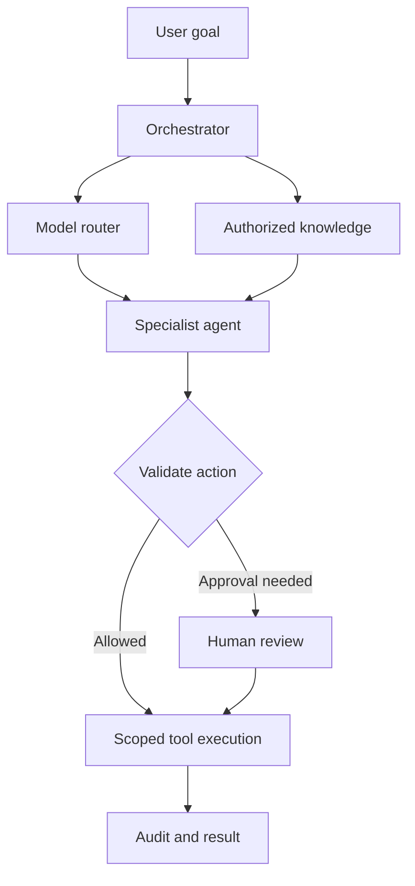

# MASTER AI - Knowledge Center

A static, searchable development playbook hosted with GitHub Pages. This application is a documentation reader. The agents, integrations, metrics and pricing described in the playbook are reference examples, not running services or measured results.

Custom domain: https://app-bible.jelvan.pro  
Default Pages URL: https://devjel.github.io/knowledge-center-system/

## Separate HTML pages

Each topic now has its own HTML document and URL; the main page displays Overview only. Shared assets live in assets/. Navigation loads a new document rather than scrolling through all topics. Legacy index.html hash links redirect to the matching HTML page.

- [Detailed Page 1 HTML](chapter-01-production-ai-architecture.html)
- [Page map](docs/HTML_PAGES.md)

## Standalone technical chapters

1. [Production AI Application Architecture and Request Lifecycle](docs/pages/01-production-ai-architecture.md) — version 1.0.0, reviewed 2 November 2026. Includes complete TypeScript lifecycle and acceptance tests, policy configuration, failure analysis and Mermaid diagrams.

## Guides

- [Consistent chapter pattern and Knowledge Center features](docs/CHAPTER_PATTERN.md)

- [Researched AI and LLM task matrix](docs/AI_RESEARCH.md)
- [Mermaid diagram library](docs/DIAGRAMS.md)

- [Engineering knowledge: databases, authentication, OTP, email and operations](docs/ENGINEERING_KNOWLEDGE.md)

- [User guide and section reference](docs/USER_GUIDE.md)
- [Deployment, DNS, HTTPS and rollback](docs/DEPLOYMENT.md)
- [Architecture and maintenance](docs/ARCHITECTURE.md)
- [Changelog](CHANGELOG.md)

## Local preview

Serve the repository root with `python3 -m http.server 8080`, then open http://localhost:8080. No build, package installation, API key or database is required.

## Branding and navigation

The favicon reproduces the red hexagon and three dots of the application logo. Browser titles follow “Section name | MASTER AI - Knowledge Center”. Twenty-four sections have shareable hash links. Search filters section names; Ctrl+K or Command+K focuses search. Mobile navigation and a color-theme toggle are available.

## Hosting status

GitHub Actions publishes pushes to main. Cloudflare provides DNS only, with app-bible.jelvan.pro pointing to devjel.github.io. A repository CNAME file records the intended domain. Actions publishing still requires the custom domain to be configured in GitHub Settings → Pages, followed by certificate validation and Enforce HTTPS. DNS alone does not confirm that the custom domain is live.

---

## Original reference playbook

The material below is preserved as reference guidance. Validate technology choices, estimates and thresholds for each implementation.

# MASTER AI • Multi-Agent Operating System

### Production-Grade Development Playbook & README

Welcome to the **Master AI Development** ecosystem. This complete README file is aligned with the production-grade multi-agent operating system architecture, structured for startup operators, engineers, and technical founders looking to build autonomous workflows without the operational toil.

---

## 📋 Table of Contents

1. Overview & Vision
2. Phase 1: Discovery & Scoping
3. Phase 2: System Architecture
4. Phase 3: Data & Prototyping
5. Phase 4: Agent Development
6. Phase 5: Client-in-the-Loop
7. Phase 6: Deployment
8. Phase 7: Post-Launch & Scale
9. Appendices & Glossary

---

## 00. Overview & Vision

Master AI is not a chatbot—it is a **multi-agent operating system** designed to replace fragmented SaaS workflows with coordinated autonomous agents that plan, act, and report. A Master Orchestrator decomposes high-level business goals into tasks distributed across specialist worker agents.

* **The Problem:** Modern startups juggle 12+ siloed tools (Slack, Notion, CRMs), forcing founders and operators to act as human routers.
* **The Solution:** A unified OS where agents handle intake, deep research, multi-step execution, and structured reporting behind secure audit trails.
* **The Outcome:** An 80% reduction in operational toil and decision latency compressed from days to minutes.

### Target Operator Segments

| Segment | Use Case | Typical Agent Load |
| --- | --- | --- |
| **Pre-seed → Seed** | Founder operations, automated investor updates | 3 Agents |
| **Seed → Series A** | Go-To-Market (GTM) research, support triage | 5–7 Agents |
| **SMB Operations** | Finance automation, SOP execution, lead enrichment | 8–12 Agents |

---

## 01. Phase 1: Discovery & Scoping

### Onboarding Questionnaire Checklist

```yaml
discovery_intake:
  1_business_context: "ICP, GTM motions, key bottlenecks, existing stack"
  2_workflow_target: "Identify repetitive processes taking >5 hours/week"
  3_data_access: "Knowledge sources, PII boundaries, API readiness"
  4_success_metrics: "Target metric movement in 60 days & stakeholder approvals"

```

### Jobs-to-Be-Done (JTBD) Framework

* **Job Statement Template:** *When [situation], I want to [motivation] so I can [outcome].*
* *Example:* When a new inbound lead books a demo, I want automated company research and tailored talking points so I can run discovery in 10 minutes instead of 1 hour.


* **Forces Diagram:**
* $\rightarrow$ **Push:** Current operational friction & manual bottleneck pain.
* $\rightarrow$ **Pull:** Desired speed, structured insights, and consistency.
* $\leftarrow$ **Anxiety:** Hallucination risks, data leakage, and system trust.
* $\leftarrow$ **Habit:** Operator preference for manual control.


### MoSCoW Feature Prioritization

* **Must Have:** Master Orchestrator, 2 core specialist agents, Model Context Protocol (MCP) tool bus, and human approval gates.
* **Should Have:** Persistent memory layer, observability tracing, and Slack integration.
* **Could Have:** Voice agent interface, auto-retraining pipeline, and executive dashboards.
* **Won't Have (MVP):** Native mobile apps, multi-tenant public billing, or complex fine-tuning.

---

## 02. Phase 2: System Architecture

### Multi-Agent Orchestrator Topology



### Core Tech Stack Recommendations

| Layer | Production Choice | Rationale |
| --- | --- | --- |
| **Orchestration** | LangGraph / Temporal | Stateful Directed Acyclic Graphs (DAGs) with robust retries |
| **LLM Router** | LiteLLM + Martian | Intelligent model fallbacks and cost optimization |
| **Memory** | Qdrant + PostgreSQL | Hybrid vector storage and structured relational episodic logs |
| **Tooling Bus** | MCP (Model Context Protocol) | Standardized, secure, modular tool execution interface |

---

## 03. Phase 3: Data & Prototyping

### Golden Dataset Schema Specification

```yaml
golden_dataset_row:
  id: "lead_001"
  input_query: "Perform deep research on Acme Inc for upcoming enterprise pitch."
  expected_output: "{overview: '...', tech_stack: '...', signals: '...'}"
  source_doc_ids: ["notion:workspace_123"]
  complexity: "medium"
  risk_level: "low"

```

### Prototyping Sprint Checklist

* **Days 1–2:** Build single agent workflow using 10 golden dataset rows.
* **Days 3–4:** Introduce orchestrator logic and test failure modes.
* **Day 5:** Integrate memory layers and quantify performance improvements.
* **Day 6–7:** Implement human-in-the-loop validation UI and measure approval latency.
* **Exit Criteria:** $\ge 85\%$ golden dataset pass rate and $< 2\%$ hallucination rate.

---

## 04. Phase 4: Agent Development

### Agent Prompt Engineering Standard

```markdown
ROLE: You are [Agent Name], a specialist in [Domain].
CONTEXT: Company context and operating boundaries.
CONSTRAINTS: Use only verified tools provided; cite all external facts.
TASK: [Specific Decomposed Task Instructions]
EVAL: Self-check output against strict factuality and format criteria before responding.

```

### Evaluation & Guardrail Thresholds

| Dimension | Metric | Production Threshold |
| --- | --- | --- |
| **Accuracy** | Human expert preference score | $\ge 85\%$ |
| **Hallucination** | Natural Language Inference (NLI) check | $\le 2\%$ |
| **Latency** | p95 end-to-end task completion | $\le 4.5\text{s}$ per sub-agent step |
| **Cost** | Average compute cost per workflow run | $\le \$0.40$ |

---

## 05. Phase 5: Client-in-the-Loop

* **Weekly Development Cadence:**
* **Monday:** Planning & Loom sprint demo.
* **Tuesday–Wednesday:** Active agentic build & real-time trace updates in Slack.
* **Thursday:** Client staging QA and feedback collection.
* **Friday:** Retrospective, metrics review, and backlog grooming.


* **Feedback Capture Loop:** Every execution run includes thumbs up/down inline feedback widgets. Negative feedback automatically generates a tracked issue ticket with attached execution traces.

---

## 06. Phase 6: Deployment

### Containerization Dockerfile Template

```dockerfile
FROM python:3.11-slim
WORKDIR /app
COPY requirements.txt .
RUN pip install --no-cache-dir -r requirements.txt
COPY . .
EXPOSE 8080
CMD ["uvicorn", "app.main:app", "--host", "0.0.0.0", "--port", "8080"]

```

### Deployment Governance Modes

1. **Human-in-the-Loop:** Every external side effect (emails, API posts, financial transactions) requires explicit human sign-off. (Default for first 30 days).
2. **On-Loop Mode:** Agents execute tasks autonomously; human operators review batches asynchronously for low-risk workflows.
3. **Fully Autonomous:** Unattended execution allowed only when agent accuracy exceeds $95\%$ over 500 consecutive runs.

---

## 07. Phase 7: Post-Launch & Scale

### Automated Prompt Optimization Pipeline

* **Trigger:** Weekly schedule OR when user corrections exceed 50 instances.
* **Action:** Collect feedback logs $\rightarrow$ Curate dataset $\rightarrow$ Run evaluation suite on holdout set $\rightarrow$ Promote improved prompt via automated pull request if accuracy increases by $\ge 2\%$.

### Cost & Token Optimization Levers

* Route low-complexity extraction and classification tasks to efficient models (e.g., Claude Haiku or GPT-4o-mini), saving up to $60\%$ on inference costs.
* Implement semantic caching for frequent queries.
* Summarize episodic memory contexts to reduce token overhead by up to $40\%$.

---

## 08. Appendices

### Glossary

* **Orchestrator:** The primary coordinator agent that breaks user goals into directed acyclic graphs (DAGs) of tasks.
* **MCP (Model Context Protocol):** An open standard for securely connecting AI models to data sources and external tools.
* **Golden Set:** A curated collection of verified input-output pairs used for rigorous regression testing and evaluation.
* **Trace:** A comprehensive audit log recording every intermediate reasoning step, token usage, cost, and tool call.

### Change Log

* **v1.0 (Nov 2025):** Initial production release featuring the 7-phase development lifecycle, multi-agent orchestrator design, evaluation frameworks, and deployment specs.
