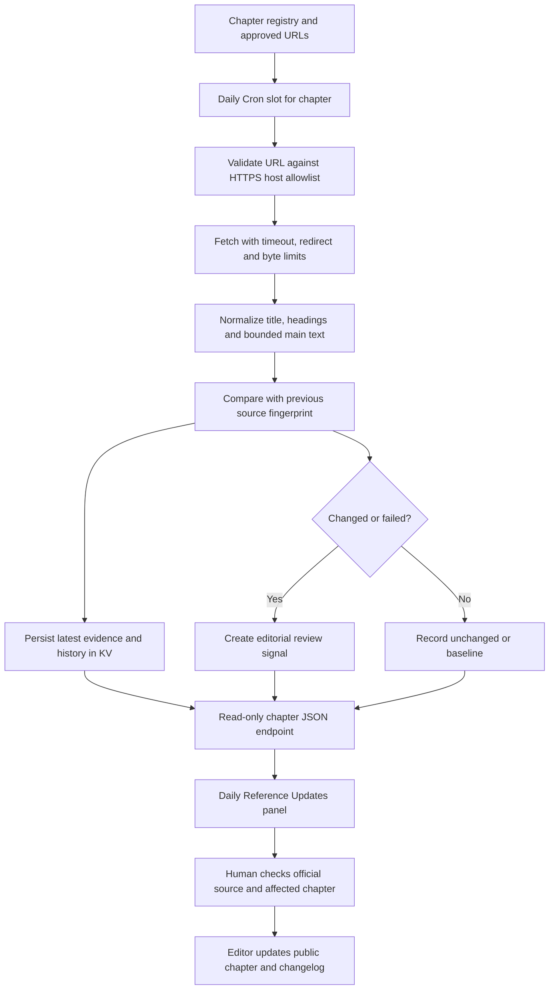

# MASTER AI Knowledge Center — Web Development & Engineering

**Public developer reference · Standalone chapters · Official-source monitoring**

The MASTER AI Knowledge Center is a public, chapter-based learning resource for developers, technical leads, architects and operators. It explains how to plan, design, build, secure, test, deploy and operate modern web applications and AI-enabled systems.

The material is written as practical engineering guidance: concepts are explained in context, decisions are compared, implementation steps are ordered, examples are annotated, failure cases are discussed and Mermaid diagrams show how components interact. Each topic has its own shareable HTML page.

- **Public knowledge center:** https://app-bible.jelvan.pro/
- **Default hosted reader:** https://devjel.github.io/knowledge-center-system/
- **Reference update operations:** [Daily Reference Updates](docs/DAILY_UPDATES.md)
- **Per-page source and sync map:** [Chapter Auto-Sync Map](docs/CHAPTER_AUTOSYNC_MAP.md)
- **Complete page directory:** [HTML Page Map](docs/HTML_PAGES.md)
- **Chapter writing standard:** [Chapter Pattern](docs/CHAPTER_PATTERN.md)
- **Reader instructions:** [User Guide](docs/USER_GUIDE.md)
- **System architecture:** [Architecture](docs/ARCHITECTURE.md)
- **Deployment and recovery:** [Deployment Guide](docs/DEPLOYMENT.md)
- **Release history:** [Changelog](CHANGELOG.md)

> This is an educational documentation site, not a hosted application platform. Code, product selections, thresholds and architecture patterns are examples. The site does not provide authentication, send email, run AI agents, store customer data or deploy the systems described in its chapters.

---

## 1. What each chapter provides

Chapters are designed to follow a consistent reading and engineering pattern:

1. **Description and purpose** — what the topic is, why it exists, where it fits and when to use it.
2. **Architecture and boundaries** — the components, trust boundaries, responsibilities and dependencies.
3. **Implementation process** — an ordered workflow from prerequisites to verification.
4. **Specific examples** — realistic request flows, data models, configuration, code and expected results.
5. **Decision guidance** — alternatives, trade-offs, selection criteria and assumptions.
6. **Mermaid diagrams** — process, sequence, state or architecture diagrams with readable source.
7. **Security and failure handling** — abuse cases, edge cases, retries, recovery and safe defaults.
8. **Testing and acceptance** — what to test and what evidence proves that the feature works.
9. **Operations and maintenance** — observability, ownership, lifecycle and change management.
10. **Related chapters and official references** — a connected learning path and sources to verify current behavior.

Use the chapter directory below to open the exact topic. The same directory and source mapping are maintained in [docs/HTML_PAGES.md](docs/HTML_PAGES.md).

## 2. Chapter directory

All chapter links below open standalone pages on the public site. The relative links also work when the documentation is previewed from the site root.

### Foundations

| Chapter | Description | Public page |
|---|---|---|
| Overview & Vision | System goals, intended users, operating model, use cases and success criteria. | [Open Overview](https://app-bible.jelvan.pro/overview.html) |
| Discovery & Scoping | Requirements, stakeholder discovery, workflow mapping, constraints, prioritization and measurable outcomes. | [Open Discovery](https://app-bible.jelvan.pro/phase1.html) |
| System Architecture | Application boundaries, orchestration, component responsibilities, trust zones and architecture decisions. | [Open Architecture](https://app-bible.jelvan.pro/phase2.html) |
| Data & Prototyping | Data classification, sample datasets, prototypes, evaluation plans and proof-of-concept exit criteria. | [Open Data & Prototyping](https://app-bible.jelvan.pro/phase3.html) |
| Agent Development | Agent responsibilities, prompts, tools, structured outputs, evaluation and bounded execution. | [Open Agent Development](https://app-bible.jelvan.pro/phase4.html) |
| Client Review & Feedback | Human review, approval boundaries, feedback capture, auditability and revision cycles. | [Open Client Review](https://app-bible.jelvan.pro/phase5.html) |
| Deployment | Build and release workflows, environment separation, configuration, verification and rollback. | [Open Deployment](https://app-bible.jelvan.pro/phase6.html) |
| Post-Launch & Scale | Production operations, capacity, cost controls, reliability, service objectives and continuous improvement. | [Open Post-Launch](https://app-bible.jelvan.pro/phase7.html) |
| Glossary & Reference Templates | Shared terminology, reusable templates, checklists and reference material. | [Open Appendices](https://app-bible.jelvan.pro/appendices.html) |

### Application platform

| Chapter | Description | Public page |
|---|---|---|
| Databases & Storage | Relational and object storage, schema design, tenant isolation, migrations, indexing, backup and restore. | [Open Databases](https://app-bible.jelvan.pro/databases.html) |
| Authentication & SSO | Identity proof, password flows, federation, OIDC/SAML concepts, MFA sequencing and account recovery. | [Open Authentication](https://app-bible.jelvan.pro/authentication.html) |
| Sessions & Authorization | Session lifecycle, cookies, access policies, resource-level checks, revocation and tenant-scoped authorization. | [Open Sessions](https://app-bible.jelvan.pro/sessions.html) |
| Email OTP & Recovery | Challenge generation, delivery, expiry, rate limits, atomic consumption, replay prevention and recovery controls. | [Open OTP](https://app-bible.jelvan.pro/otp.html) |
| Email Delivery | Transactional email architecture, sender authentication, templates, queues, provider outcomes, bounces and complaints. | [Open Email](https://app-bible.jelvan.pro/email.html) |
| APIs & Webhooks | Resource contracts, validation, authorization, idempotency, pagination, webhook signatures and versioning. | [Open APIs](https://app-bible.jelvan.pro/apis.html) |
| Cloud, DNS & Secrets | Hosting boundaries, DNS, TLS, runtime bindings, secrets, environments, service identities and deployment safety. | [Open Infrastructure](https://app-bible.jelvan.pro/infrastructure.html) |
| Queues & Reliability | Background jobs, event envelopes, outbox patterns, retries, idempotency, dead-letter queues and recovery. | [Open Queues](https://app-bible.jelvan.pro/queues.html) |

### AI engineering

| Chapter | Description | Public page |
|---|---|---|
| AI, RAG & Tool Security | Retrieval boundaries, untrusted context, prompt injection, tool authorization, data isolation and approval gates. | [Open AI Security](https://app-bible.jelvan.pro/ai-security.html) |
| LLMs by Task | Model selection by task, capability, context, latency, privacy, reliability, evaluation and cost. | [Open LLM Selection](https://app-bible.jelvan.pro/llm-selection.html) |
| AI Research & Updates | Provider announcements, deprecations, model changes, source verification and editorial review. | [Open AI Updates](https://app-bible.jelvan.pro/ai-updates.html) |
| Model Routing & Evaluation | Policy-aware model selection, evaluation thresholds, fallbacks, budgets, telemetry and routing drift. | [Open Model Routing](https://app-bible.jelvan.pro/model-routing.html) |

### Operations, quality and implementation

| Chapter | Description | Public page |
|---|---|---|
| Testing & Accessibility | Unit, integration, end-to-end, security, performance and accessibility testing with release evidence. | [Open Quality](https://app-bible.jelvan.pro/quality.html) |
| Monitoring & Recovery | Logs, metrics, traces, service objectives, privacy-aware audit, incident response and restore practice. | [Open Operations](https://app-bible.jelvan.pro/operations.html) |
| Mermaid Diagram Library | Flowcharts, sequence diagrams, state diagrams, ER diagrams, architecture views and diagram review. | [Open Mermaid Library](https://app-bible.jelvan.pro/mermaid-diagrams.html) |
| Production AI Architecture | An end-to-end request lifecycle with identity, retrieval, model execution, tool policy, approval and audit. | [Open Production AI Architecture](https://app-bible.jelvan.pro/chapter-01-production-ai-architecture.html) |
| Worker Architecture & Implementation | Event-driven handlers, scheduled work, bindings, bounded fetches, KV state, observability and testing. | [Open Worker Implementation](https://app-bible.jelvan.pro/worker-implementation.html) |
| Web Application Engineering | End-to-end web development from discovery and UI through APIs, data, security, testing, deployment and operations. | [Open Web Application Engineering](https://app-bible.jelvan.pro/web-application-engineering.html) |

**Navigation rule:** each link opens a distinct HTML document. The page map is the canonical local file-to-topic directory; the public URLs above are the reader-facing links.

---

## 3. Official-reference auto-sync

The knowledge center includes a separate Cloudflare Worker named `knowledge-center-updates`. Its responsibility is to observe approved official documentation references and make the latest check evidence available to each chapter's **Daily Reference Updates** panel.

### What auto-sync does

- Uses the versioned chapter registry at `config/chapters.json` to map a chapter to its approved reference URLs.
- Checks the mapped HTTPS sources on a daily per-chapter schedule.
- Uses bounded requests, timeouts, redirect checks, response-size limits and an allowlist derived from registered source hosts.
- Compares the page title, first five main headings and a bounded normalized sample of main-page text.
- Stores per-source status, timestamps, response metadata and a limited history in the dedicated KV namespace.
- Detects source heading/content changes and failed checks, then records an editorial review signal.
- Exposes read-only JSON endpoints used by the chapter panels.
- Supports an authenticated server-to-server refresh route for a selected chapter when the required Worker secret is configured.

### What auto-sync does not do

A detected source change is **not** automatically treated as a technical fact or a command to rewrite the chapter. Source pages can change navigation, layout, advertisements or wording without changing the underlying technical behavior. The Worker does not silently edit public HTML, generate code, change security policy or publish an unreviewed technical recommendation. A human editor compares the official source, validates the impact, updates the chapter and records the revision.

This separation keeps source monitoring automatic while preserving editorial responsibility for public developer guidance.

### Current schedule

The Worker Cron expression is `0-26 0 * * *` (UTC). This corresponds to **08:00–08:26 daily in Asia/Kuala_Lumpur**. One chapter is assigned to each minute according to its zero-based registry order. There are 27 chapter slots; the overview is a real chapter and is checked once, not duplicated as an index alias.

The schedule is a monitoring cadence, not a guarantee that every provider will respond successfully. A source can block automated requests, rate-limit the Worker or return an error. The panel must show that condition rather than imply that a failed check succeeded.

### Auto-sync architecture



### Status meanings

| Status | Meaning | Recommended action |
|---|---|---|
| `pending` | No successful stored observation exists yet. | Wait for the scheduled slot or use an authorized refresh. |
| `baseline` | First successful observation; establishes comparison state. | No change claim should be made from a baseline alone. |
| `unchanged` | The compared content fingerprint is unchanged, or a valid conditional response reused prior evidence. | No editorial action unless another issue is known. |
| `outline_changed` | The title or compared headings changed. | Review the official source and affected chapter. |
| `content_changed` | The bounded normalized main text changed while headings may remain the same. | Compare the exact technical behavior, examples and version notes. |
| `check_failed` | A source could not be evaluated. Previous successful evidence is retained where available. | Investigate URL, provider restrictions, rate limits or service failure. |
| `partial` | At least one source succeeded and at least one source failed. | Review failed sources; do not call the chapter fully synchronized. |
| `failed` | All mapped source checks failed. | Treat displayed successful evidence as stale and investigate. |

### Where to configure and maintain auto-sync

| Concern | Authoritative location | Responsibility |
|---|---|---|
| Chapter names, order, related pages and approved source URLs | `config/chapters.json` | Editorial source-of-truth registry |
| Runtime registry and scheduled/check logic | `workers/knowledge-center-updates/worker.mjs` | Worker implementation; keep registry synchronized |
| Runtime bindings, compatibility and schedule manifest | `workers/knowledge-center-updates/wrangler.jsonc` | Deployment configuration |
| Automated behavior tests | `workers/knowledge-center-updates/worker.test.mjs` | Regression and failure-path coverage |
| Chapter panel rendering and status labels | `assets/daily-updates.js` | Public reader integration |
| Panel presentation | `assets/chapters.css` | Responsive status and review presentation |
| Generated public search data | `assets/search-index.json` | Rebuilt from chapter content |
| Per-page source map | `docs/CHAPTER_AUTOSYNC_MAP.md` | Human-readable mapping and review guide |
| Operational procedure and endpoint contract | `docs/DAILY_UPDATES.md` | Operator runbook |

For the full process, secret requirements, endpoints, tests, limits, deployment separation and rollback, read [Daily Reference Updates — Operations and Implementation](docs/DAILY_UPDATES.md). For every chapter's exact source URLs, read [Chapter Auto-Sync Map](docs/CHAPTER_AUTOSYNC_MAP.md).

---

## 4. How to update a chapter safely

1. Open the chapter's **Daily Reference Updates** panel and note its last attempt, last successful check and any review signal.
2. Open the official source link shown by the panel. Verify the page itself; do not rely on the detected title or heading change alone.
3. Identify the exact affected section, API behavior, version, deprecation date, security recommendation or code sample.
4. Check a second authoritative source when the change is consequential or ambiguous.
5. Update the relevant chapter explanation, decision criteria, code, diagram and related links together.
6. Update cross-references and the source mapping if the official reference URL changed.
7. Record the editorial decision, source checked date, affected chapter and revision in the changelog.
8. Run the documented Worker tests, registry checks, search build, structural checks and JavaScript syntax checks.
9. Deploy the Worker separately when its code, registry, binding or schedule changes. Static page publication alone does not deploy Worker code.
10. Inspect the public chapter and its update panel after publication.

Never place a Worker token, API key, SMTP password or other secret in public HTML, a browser script, a public JSON file or a documentation example.

---

## 5. Local preview and validation

Serve the project root over HTTP:

```sh
python3 -m http.server 8080
```

Then open `http://localhost:8080/`.

Run the documentation checks from the project root:

```sh
node --test workers/knowledge-center-updates/worker.test.mjs
python3 scripts/check_registry.py
python3 scripts/build_search.py
python3 scripts/check_docs.py .
node --check assets/daily-updates.js
node --check workers/knowledge-center-updates/worker.mjs
```

The test suite uses controlled mock responses. It verifies application behavior and failure handling; it does not prove that every live provider URL is reachable. A live Worker check and a successful static-site deployment are separate verification steps.

---

## 6. Hosting and runtime boundaries

- The reader is a static collection of HTML, CSS, JavaScript and generated search data.
- Static site publication is handled by GitHub Pages.
- Cloudflare provides DNS for the custom hostname and separately runs the reference-monitoring Worker.
- The Worker uses a dedicated KV namespace through the `UPDATE_STATE` binding.
- The browser reads public source-check metadata; it must never receive the manual refresh secret.
- A successful static-site publication does not deploy Worker source.
- A successful Worker upload does not prove that every external source was reachable or that the custom domain is serving the newest browser cache.

For DNS, HTTPS, publishing and rollback details, see [Deployment Guide](docs/DEPLOYMENT.md). For service boundaries and data flow, see [Architecture](docs/ARCHITECTURE.md).

## 7. Editorial and technical quality standard

Public chapters should be understandable without assuming that the reader already knows the product ecosystem. Define acronyms on first use, explain why each step exists, state prerequisites and expected outcomes, identify which code runs in the browser versus the server, distinguish illustrative configuration from deployable configuration, and call out provider-specific assumptions.

Prefer current official documentation for API behavior and security claims. Date time-sensitive comparisons. Do not present benchmark numbers, pricing, product availability or performance thresholds as universal facts unless the source, test conditions and date are stated.

**The goal is not simply to list technologies. It is to teach a developer how to make a sound decision, implement it safely, prove it works and maintain it as the underlying platforms change.**
