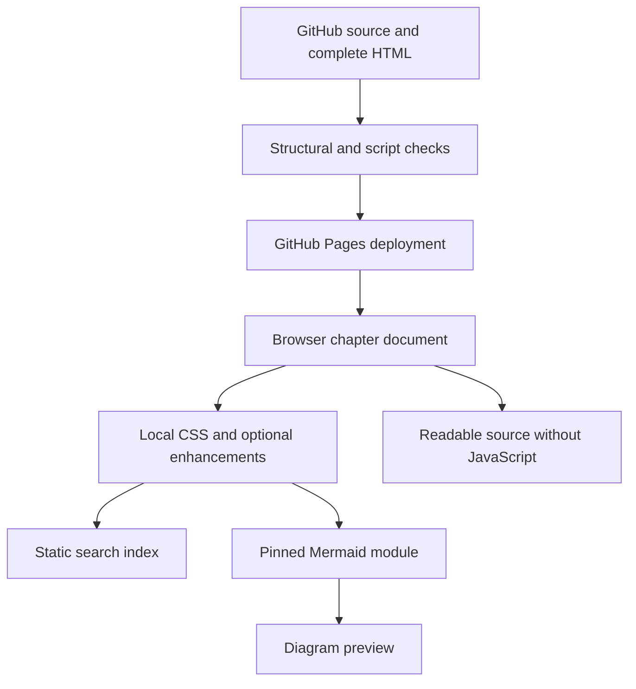

# Knowledge Center Architecture

Version 2.1.0 — reviewed 2 November 2026

## Current application

The production source is a collection of complete standalone HTML chapters. Each HTML embeds its article, examples, Mermaid source, table of contents and navigation. index.html displays Overview and preserves recognized legacy hash redirects. The twenty-five distinct chapters are searchable through a static generated JSON index.

Cloudflare supplies DNS for the intended custom domain. GitHub Pages supplies hosting. No database, SMTP transport, authentication server or model inference backend is enabled by this documentation site. Those technologies are instructional subjects.

## Boundaries and features

- HTML is the authoritative reader-facing content; no React hydration or content API is required.
- assets/chapters.css supplies responsive desktop, mobile, keyboard-focus and print presentation.
- assets/chapters.js adds copy controls, code wrapping, persistent theme preference, navigation filtering, full chapter search, reading progress and diagram previews.
- assets/search-index.json includes title, URL and text for every distinct chapter. It contains public content only.
- Mermaid is loaded from a version-pinned CDN. Strict rendering applies; one invalid diagram does not prevent other previews. Copyable source remains visible if the CDN fails.
- Search results use textContent and createElement rather than interpreting indexed content as HTML.
- Clipboard denial falls back to a user-triggered legacy copy attempt; failure is announced accessibly.
- Theme preference is stored locally; storage denial does not prevent reading.

## Validation and release

scripts/check_docs.py uses Python's standard library to check headings, landmarks, active navigation, duplicate IDs, local assets, same-page anchors and index coverage. The publishing workflow runs it and a JavaScript syntax check before uploading Pages content.

Structural checks passed on all twenty-six HTML documents during this review. These checks do not establish visual rendering, clipboard permission, Mermaid CDN access or live custom-domain TLS. Validate those in the target browser after deployment.

## Maintenance

Update the HTML and matching search-index entry together. The search coverage check detects missing chapter records, but semantic freshness requires review. Maintain previous/next links and page outlines when adding sections. Private information must not be placed in HTML or the search index. Remove superseded renderer assets only after confirming no active HTML references them.

## Daily source updater — 3 November 2026

The site now has twenty-six distinct chapters and twenty-seven HTML documents including the overview alias. A separate Cloudflare Worker, knowledge-center-updates, binds an isolated KV namespace and checks registered references daily. The API serves public source-outline evidence to assets/daily-updates.js; it does not power sign-in, inference, email or business-data storage. The reader remains complete static HTML. See [Daily Updates](DAILY_UPDATES.md) for the exact comparison scope, schedule, state semantics, tests and deployment boundary.

Navigation grouping and related links are specified in config/chapters.json. scripts/build_search.py indexes entire articles, including nested technical cards. Publishing now validates the embedded Worker registry, daily schedule, source bounds, search freshness and updater unit tests.
