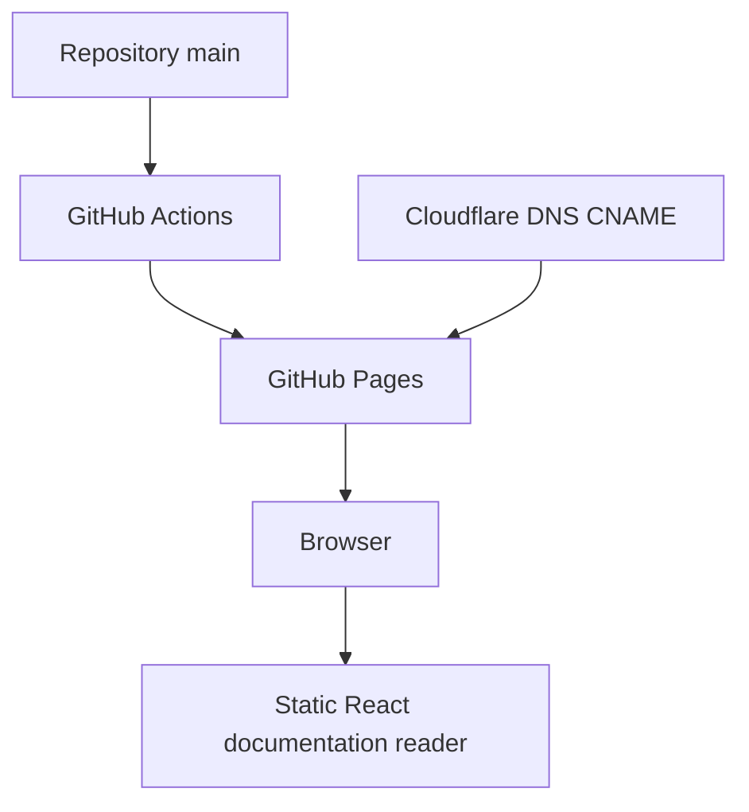

# Architecture and maintenance

## Actual application

The site is an exported single HTML document containing compiled React code and styles. It renders into #root. Browser state controls theme, search, active section and the mobile menu. IntersectionObserver tracks visible sections. URL hashes support direct section links and history navigation. There are no server APIs, secrets, persistent user records or agent runtimes.

## Files

| Path | Role |
| --- | --- |
| index.html | Exported application, inline styles and scripts |
| favicon.svg | Same geometry and red accent as the application logo |
| CNAME | Intended custom hostname |
| .github/workflows/static.yml | GitHub Pages publication |
| README.md | Project entry point and preserved reference playbook |
| docs/ | User and operational guides |
| CHANGELOG.md | Application release notes |

## Editing

Keep each navigation ID aligned with its section ID and the guide. The navigation array eu contains labels and IDs; nu is the main compiled component; tu renders the existing logo. The browser-title effect derives its label from the navigation array. favicon.svg reuses tu's path and circles on a dark background.

Because this is compiled output, make small targeted edits and check JavaScript syntax before publication. For major redesigns, establish maintainable source files and a reproducible build before replacing this export. Preserve third-party license comments in the embedded runtime.

## Validation and limitations

Check script parsing, all nine section targets, metadata and favicon links. Then verify behavior in a browser using the deployment checklist. Syntax checks do not prove rendering or live HTTPS.

The current article's orchestration, cloud, monitoring and billing examples describe systems a reader could build. They are not dependencies or features of this static site. Model names, platform details and quantitative estimates in the original playbook need independent verification before operational use.
