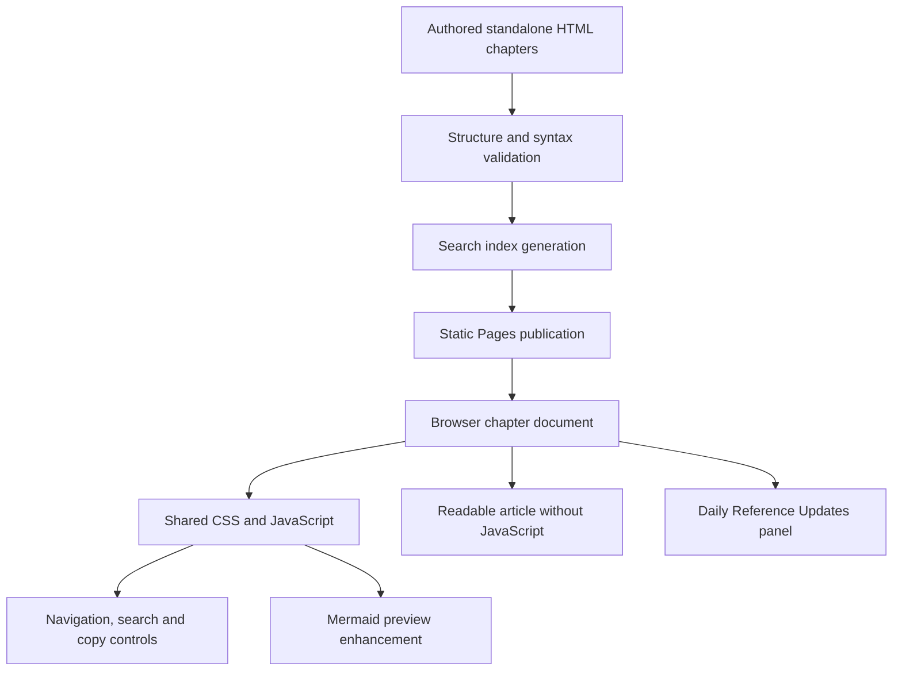
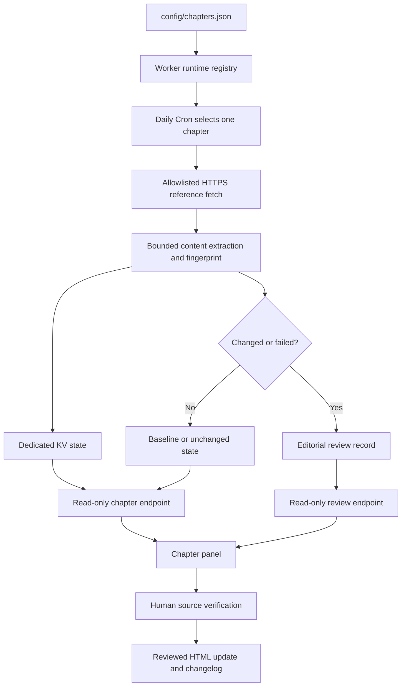

# MASTER AI Knowledge Center — System Architecture

Version 3.0.0 · Reviewed 3 November 2026

## System overview

The Knowledge Center is a static public reader composed of 27 standalone topic chapters, a home/index experience, shared presentation assets and a generated search index. A separate Cloudflare Worker monitors approved external references and serves source-check evidence to the chapter panels.

The reader and reference monitor are separate systems:

- **Static documentation layer:** renders the authored HTML chapters, search, navigation, code examples and Mermaid diagrams.
- **Reference-monitoring layer:** checks approved official URLs, stores bounded evidence in KV and exposes read-only JSON.
- **Editorial layer:** a human verifies a detected source change and decides whether to update public technical guidance.
- **Publishing layer:** static page publication and Worker deployment are separate release operations.

## Static reader architecture



## Reference monitoring architecture



## Components and responsibilities

| Component | Responsibility | Must not be used for |
|---|---|---|
| Standalone HTML chapters | Authoritative public prose, examples, diagrams and page navigation | Storing credentials or private customer records |
| assets/chapters.css | Responsive, readable and accessible presentation | Application business logic |
| assets/chapters.js | Navigation, search, copy controls, theme and diagram enhancement | Trusting remote content or authorizing server actions |
| assets/daily-updates.js | Fetch and safely render public monitoring metadata | Triggering privileged refreshes or holding secrets |
| assets/search-index.json | Generated public chapter search data | Storing private or unpublished content |
| config/chapters.json | Canonical chapter metadata and approved source URLs | Runtime secret storage |
| workers/knowledge-center-updates/worker.mjs | Scheduled and authorized source checks, fingerprints, KV state and review records | Automatically editing or publishing technical prose |
| Cloudflare KV / UPDATE_STATE | Bounded public monitoring state and review evidence | Authentication sessions, payment records or strongly consistent security decisions |
| docs/CHAPTER_AUTOSYNC_MAP.md | Human-readable per-chapter source mapping | Replacing the machine-readable registry |

## Hosting and service boundaries

- Static site publication is handled by GitHub Pages.
- Cloudflare supplies DNS for the public custom hostname and separately runs the reference Worker.
- The Worker uses its dedicated KV namespace through UPDATE_STATE.
- The browser retrieves only public source-monitoring metadata.
- The manual refresh endpoint, when configured, is server-to-server and protected by a Worker secret.
- No database, authentication server, SMTP transport, AI inference or agent execution is enabled by the static reader itself. Those subjects are explained in the public chapters.

A successful static page deployment does not deploy Worker source. A successful Worker deployment does not publish new chapter prose. Verify the two release paths independently.

## Search and page behavior

- Each chapter is a distinct HTML document with its own public URL.
- The generated search index contains public title, URL and article text.
- Search content must be rebuilt after chapter changes.
- Remote values from the Worker are inserted as text, not interpreted as HTML.
- Mermaid preview uses a pinned external module; readable source remains available if the CDN fails.
- Clipboard and local theme preferences are progressive enhancements. A browser permission or storage failure must not prevent reading.

## Security and privacy boundaries

- The reference Worker only checks registry-approved HTTPS hosts.
- Fetches use bounded redirects, timeouts and response sizes.
- Source content is treated as untrusted data and never executed.
- The public reader cannot obtain the manual refresh secret.
- CORS is not treated as authentication.
- Monitoring records contain public source metadata and bounded observations, not credentials.
- No external source is allowed to instruct the Worker to alter the repository or public article.

## Validation and release

From the project root:

```sh
node --test workers/knowledge-center-updates/worker.test.mjs
python3 scripts/check_registry.py
python3 scripts/build_search.py
python3 scripts/check_docs.py .
node --check assets/daily-updates.js
node --check workers/knowledge-center-updates/worker.mjs
```

The checks validate repository structure and deterministic Worker behavior. They do not prove every external provider will accept automated requests or that the custom domain is rendering correctly in every browser.

## Maintenance documents

- [Public chapter directory](HTML_PAGES.md)
- [Per-chapter reference mapping](CHAPTER_AUTOSYNC_MAP.md)
- [Daily update operations and endpoint contract](DAILY_UPDATES.md)
- [Chapter authoring standard](CHAPTER_PATTERN.md)
- [Reader Guide](USER_GUIDE.md)
- [Deployment and rollback](DEPLOYMENT.md)

Keep the chapter registry, Worker mirror, chapter panels, page directory and auto-sync map aligned whenever chapters or reference URLs change.
