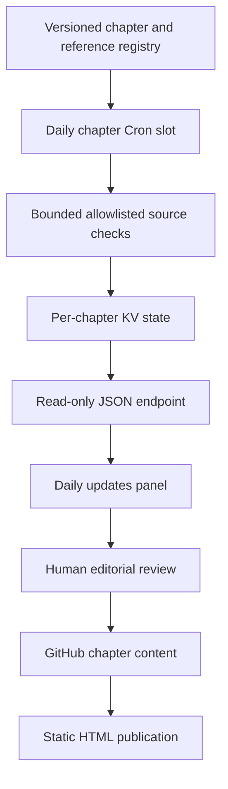

# Daily Reference Updates — Operations and Implementation

Version 1.0.0 · Reviewed 3 November 2026

## Current deployment and source state

Worker: knowledge-center-updates  
Cloudflare account: Jelvan - Projects - Works (f4411b0d8a7a6d0188d924b95344f149)  
KV namespace: knowledge-center-reference-updates (ff0e7c87fd1e42f1a3cb3972166dec64)  
Binding: UPDATE_STATE  
Existing deployed API: https://knowledge-center-updates.bolekpadjelvan.workers.dev  
Cron: `0-26 0 * * *` — 08:00–08:26 daily in Asia/Kuala_Lumpur

Each minute selects one of the twenty-seven registered chapters. The overview at index.html is an alias of overview.html and does not require a duplicate scheduled check. Cron configuration changes can take up to fifteen minutes to propagate.

## What updates automatically

Each chapter’s Daily Reference Updates panel reads the latest per-source result. The scheduled Worker checks the registered public reference URLs and stores a normalized title/heading baseline, current availability, last attempt, last successful check, last outline change, HTTP status and limited run history. A failed fetch retains previous successful metadata. A first observation is a baseline, not a newly published feature.

The comparison covers the HTML title and first five headings found after the main element within a bounded 256 KiB prefix. It does not inspect every paragraph, API example, release note or pricing change. A provider response of 304 reuses the existing outline. Document-body changes with unchanged headings may not be detected.

Existing narrative and code remain version-controlled editorial content. This service does not use a language model, invent a summary, alter authentication policies, publish GitHub commits or claim that a source check equals a complete technical review.

## File structure

```text
config/chapters.json
workers/knowledge-center-updates/worker.mjs
workers/knowledge-center-updates/wrangler.jsonc
workers/knowledge-center-updates/worker.test.mjs
assets/daily-updates.js
assets/search-index.json
scripts/build_search.py
scripts/check_registry.py
scripts/check_docs.py
worker-implementation.html
```

The Worker embeds the same registry as config/chapters.json. The registry checker prevents drift between the two. The HTML is complete independently of the update API; source-service failure must never blank the article.

## Endpoints

| Request | Result |
| --- | --- |
| GET /health | Service version, chapter count, schedule and comparison mode |
| GET /v1/chapters | Public chapter registry and scheduled minute |
| GET /v1/chapters/worker-implementation | Latest state or explicit pending state for the Worker chapter |
| GET /v1/chapters/otp | Latest state or explicit pending state for OTP |
| POST to an unrecognized or non-refresh route | 405 |
| POST /v1/refresh/{chapterId} with valid bearer secret | Immediate refresh of one registered chapter |
| GET /v1/reviews/{chapterId} | Latest editorial review signals for that chapter |
| Unknown chapter ID | 404 |
| Browser request from an unapproved Origin | 403 |

CORS permits the custom site and the GitHub Pages origin. It is not authentication. Only public reference metadata is stored and served. The public reader cannot trigger a refresh. A server-to-server manual refresh endpoint is available and requires the Worker secret `UPDATE_TRIGGER_TOKEN`; never put this secret in browser JavaScript or public HTML.

## On-demand refresh and editorial review queue

An authorized operator can request an immediate source check for one registered chapter:

```sh
curl -X POST \\
  -H 'Authorization: Bearer $UPDATE_TRIGGER_TOKEN' \\
  https://knowledge-center-updates.bolekpadjelvan.workers.dev/v1/refresh/authentication
```

The token must be configured as a Worker secret named `UPDATE_TRIGGER_TOKEN` before the manual endpoint can be used. The current source returns 503 until that secret is provisioned; an invalid token returns 401; an unknown chapter returns 404. Manual refresh bypasses the same-day schedule cache and checks only the selected chapter. It does not accept arbitrary URLs.

When a mapped source heading changes or a source check fails, the Worker stores a review item in KV. Read the latest signals for a chapter with `GET /v1/reviews/{chapterId}`. Each item records source URL, observed status, heading outline or error, detection time and last successful check. These are review signals, not proof that the technical prose is wrong.

The Worker automatically refreshes reference evidence and creates editorial review items. It does not autonomously rewrite or publish technical prose. Human review is required before changing public guidance, code examples or security recommendations. This protects the public knowledge base from source-page noise, prompt injection and unverified provider changes.

## State semantics

- `checkedAt`: last attempt, including partial or failed runs.
- `lastSuccessfulCheckAt`: latest attempt where every mapped chapter source succeeded.
- Source `lastSuccessAt`: last successful observation of that individual source.
- Source `lastChangeAt`: last observed change to the compared outline.
- `baseline`: first successful observation.
- `unchanged`: matching outline or valid 304 response.
- `outline_changed`: compared title/headings differ; editorial review is needed.
- `check_failed`: the source could not be evaluated; retained prior data may be stale.
- `pending`: no actual scheduled result has yet been stored.
- Seven run summaries are retained in the per-chapter history array. Current/last-good source state persists until changed or deliberately removed.

KV is eventually consistent. Same-day successful checks are reused, but this is not an exactly-once lock. Duplicate scheduled delivery can repeat a network check. Do not repurpose this pattern for OTP redemption, payment accounting or other strongly consistent decisions.

## Boundaries, capacity and failure handling

Fetches accept only registry-derived HTTPS hosts, reject credentials and custom ports, follow at most two allowlisted redirects, time out after eight seconds, and consume no more than 256 KiB from each source. At most three sources are checked for a chapter, sequentially. The normal schedule generates twenty-seven executions and 62 source checks per day, before redirects. Each chapter receives one scheduled slot; an authorized operator may trigger an additional check at any time. Recount the registry when changing references.

The namespace is isolated from authentication and production business data. The Worker performs no model inference and does not need an AI binding; its job is bounded source observation, on-demand checks and editorial review signals. Shared free-tier capacity, provider rate limits and CPU limits can still cause failures. Observe actual runs before expanding the workload.

If a source returns 403, 404, 429 or 5xx, keep its failure visible and investigate the URL, provider policy or availability. Do not disguise a blocked check as a successful update. If a report is older than thirty-six hours, the browser marks it stale. If a Worker invocation fails before KV write, inspect Cron history and retain the previous report.

## Tests and release

```sh
node --test workers/knowledge-center-updates/worker.test.mjs
python3 scripts/check_registry.py
python3 scripts/build_search.py
python3 scripts/build_search.py --check
python3 scripts/check_docs.py .
node --check assets/daily-updates.js
```

The publishing workflow runs registry, search, structural, syntax and Worker logic checks. The seventeen Worker tests use deterministic mock responses; they do not claim that a real provider has been contacted. A live first run must be inspected separately through Cron event history and KV reports.

Static publication and Worker deployment are separate. Pushing HTML to GitHub Pages does not deploy worker.mjs. To update the Worker, deploy its approved source and the real wrangler.jsonc in the intended account, or use the Cloudflare API. The previously deployed Worker has the 27-slot schedule and KV binding. The latest repository source adds authenticated manual refresh and review-queue endpoints; these changes are not yet live. They require a Worker deployment and `UPDATE_TRIGGER_TOKEN` secret provisioning before the new endpoints become available.

## Maintenance and rollback

1. Review and edit config/chapters.json for related links, grouping and official sources.
2. Keep the embedded CHAPTERS constant in worker.mjs synchronized.
3. Keep orders contiguous from zero and extend the Cron range for added chapters.
4. Update static HTML references, learning paths and related-chapter cards.
5. Rebuild search and run all checks.
6. Review the Worker diff, deploy it, and confirm the schedule and binding.
7. Publish the static site and inspect an actual chapter source panel.

For rollback, restore the preceding approved Worker and a compatible schedule, retaining KV evidence. For a stop, remove only this Worker’s Cron Trigger; do not remove unrelated account schedules. Human-reviewed prose changes remain normal Git commits.

## Architecture



## Official references

- https://developers.cloudflare.com/workers/configuration/cron-triggers/
- https://developers.cloudflare.com/workers/runtime-apis/handlers/scheduled/
- https://developers.cloudflare.com/workers/platform/limits/
- https://developers.cloudflare.com/kv/
