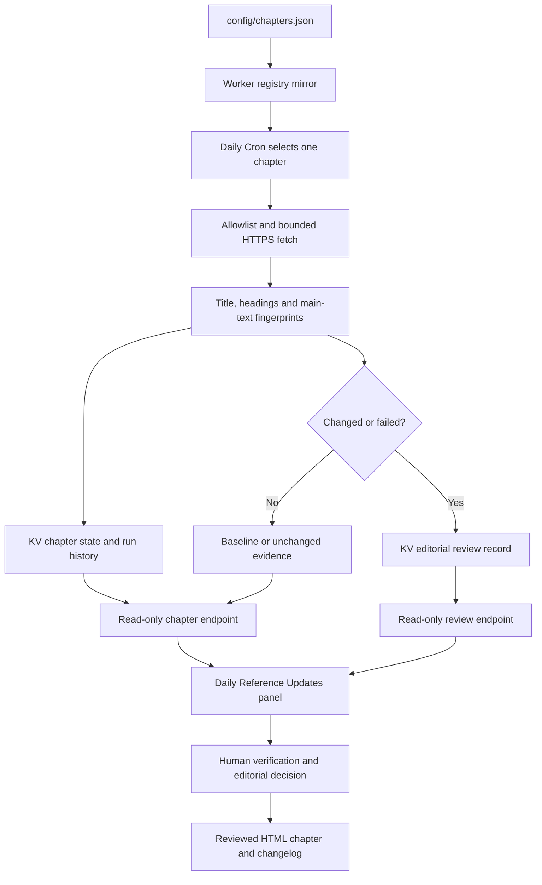

# Daily Reference Updates — Operations and Implementation

Version 1.1.0 · Reviewed 3 November 2026

## Purpose

The reference updater keeps the Knowledge Center's source evidence current. It checks the official URLs assigned to each chapter, records the result and exposes a read-only status feed to that chapter's **Daily Reference Updates** panel.

It is a source-monitoring system, not an automatic technical author. A source change creates an editorial review signal. A human must verify the source and update public prose, code, diagrams and recommendations.

## Runtime configuration

| Item | Current configuration |
|---|---|
| Worker | knowledge-center-updates |
| Cloudflare account | Jelvan - Projects - Works |
| Account ID | f4411b0d8a7a6d0188d924b95344f149 |
| KV namespace | knowledge-center-reference-updates |
| KV namespace ID | ff0e7c87fd1e42f1a3cb3972166dec64 |
| KV binding | UPDATE_STATE |
| Worker base URL | https://knowledge-center-updates.bolekpadjelvan.workers.dev |
| Cron | 0-26 0 * * * |
| Time zone shown to readers | Asia/Kuala_Lumpur |
| Local schedule | 08:00–08:26 daily |
| Chapters | 27 |
| Sources per chapter | Maximum 3 |
| Response inspection limit | 256 KiB prefix |
| Main text comparison | First 12,000 normalized characters from the bounded main-content sample |
| Request timeout | 8 seconds |
| Redirect limit | 2 allowlisted redirects |

Cloudflare Cron is expressed in UTC. The expression runs one minute slot for each of the 27 registry entries between 00:00 and 00:26 UTC, which is 08:00–08:26 in Malaysia. Each scheduled invocation checks one chapter by its zero-based registry order. The index alias is not a separate chapter and does not get a duplicate slot.

The deployed Worker schedule and KV binding have been confirmed in Cloudflare configuration. Always verify the deployed Worker source/version separately after changing runtime code; a repository commit or Pages publication does not update a Worker.

## Source of truth and file responsibilities

| File | Responsibility |
|---|---|
| config/chapters.json | Canonical chapter IDs, titles, groups, order, related pages and official source URLs |
| workers/knowledge-center-updates/worker.mjs | Runtime registry mirror, scheduled handler, source fetcher, fingerprints, state storage, review queue and JSON endpoints |
| workers/knowledge-center-updates/wrangler.jsonc | Worker name, compatibility, KV binding and deployment configuration |
| workers/knowledge-center-updates/worker.test.mjs | Deterministic tests for source checks, schedule, endpoints, failure cases and review behavior |
| assets/daily-updates.js | Public chapter-panel reader and status rendering |
| assets/chapters.css | Responsive panel, status and editorial review presentation |
| docs/CHAPTER_AUTOSYNC_MAP.md | Human-readable per-chapter source URL and schedule map |
| docs/HTML_PAGES.md | Standalone page directory and public links |
| README.md | Public overview, chapter directory and auto-sync explanation |

The registry checker verifies the embedded Worker chapter registry against config/chapters.json. Do not update one registry without the other.

## Daily execution lifecycle

1. Cloudflare invokes the scheduled handler at the minute assigned to a chapter.
2. The Worker reads the registered chapter and its existing KV state.
3. Every source URL is checked against the allowlisted HTTPS host set derived from the registry.
4. The Worker requests each source with a timeout, bounded redirects and a maximum response size. Requests are sequential to limit concurrency.
5. It extracts the document title, the first five main headings and a normalized sample of main text.
6. It computes fingerprints and compares them with the previous successful observation.
7. It stores current source evidence, status, timestamps and a limited run history in KV.
8. If a source changed or failed, the Worker creates a review record for that chapter.
9. The public page requests the chapter record and review history and displays the evidence.
10. A human editor checks the official source and decides whether the chapter itself needs a revision.

## What is compared

The Worker currently compares:

- HTML document title;
- first five H1/H2/H3 headings found within the main content;
- up to 12,000 normalized characters of main content, extracted from a bounded response prefix.

The response prefix is limited to 256 KiB. This comparison is intentionally bounded to control runtime, bandwidth and storage. It is not a full-page semantic diff. It may miss changes outside the inspected prefix, content rendered only by client-side JavaScript, PDF-only changes, API behavior changes not reflected in the fetched page, or changes behind authentication.

Conditional ETag and Last-Modified requests may return HTTP 304. In that case the previous successful fingerprint is reused and the current check time is updated. A 304 means the provider reports no change relative to the validator; it is not a fresh full-body comparison.

## Status definitions

| Status | Meaning |
|---|---|
| pending | No stored source observation is available yet. |
| baseline | First successful observation for a source; establishes a comparison fingerprint. |
| unchanged | Compared title/headings/content are unchanged, or a valid 304 response reused the previous fingerprint. |
| outline_changed | The title or compared heading outline changed. |
| content_changed | The normalized main text changed even if the title/headings stayed the same. |
| check_failed | The source could not be evaluated; prior successful evidence is retained when available. |
| checked | All registered sources for the chapter completed successfully. |
| partial | At least one source succeeded and at least one failed. |
| failed | All mapped sources failed during this chapter run. |

A baseline is not a change notification. A failed source is not an unchanged source. The UI should display last attempt and last successful timestamps separately so stale evidence is not mistaken for current confirmation.

## Public read endpoints

All reader endpoints are GET-only and expose public source metadata, not credentials.

| Method and path | Purpose |
|---|---|
| GET /health | Worker version, chapter count, schedule, time zone and capability metadata |
| GET /v1/chapters | Registered chapter IDs, titles, groups and assigned minutes |
| GET /v1/chapters/{chapterId} | Latest stored check result or explicit pending state |
| GET /v1/reviews/{chapterId} | Latest editorial review signals for a chapter |

The Worker allows the configured public site origins and the default Pages origin. CORS is a browser-origin control, not an authentication mechanism. The article remains readable if the API is unavailable.

## Authenticated on-demand refresh

The Worker source supports:

| Method and path | Purpose |
|---|---|
| POST /v1/refresh/{chapterId} | Force-check one registered chapter immediately |

This endpoint requires a Worker secret named UPDATE_TRIGGER_TOKEN and a matching Authorization: Bearer header. It returns 503 when the secret is not configured, 401 for an invalid token, 404 for an unknown chapter and a refresh result for an authorized request.

Example operator command:

```sh
curl -X POST \
  -H "Authorization: Bearer $UPDATE_TRIGGER_TOKEN" \
  https://knowledge-center-updates.bolekpadjelvan.workers.dev/v1/refresh/authentication
```

Set the token using Cloudflare Worker secret management. Never place it in README files, HTML, browser JavaScript, query strings, client-side environment variables or public issue comments. CORS does not protect this endpoint; bearer-token verification is the authorization control.

The public site must never expose a refresh button that embeds or forwards the secret. If a future admin interface is added, it must call a trusted server-side service that authenticates the operator and protects the secret.

## Editorial review workflow

A source change or source failure creates a review record in KV. The review endpoint returns the recent review signals for one chapter, including the source URL, status, detected time, observed title/headings and failure reason where available.

For each signal:

1. Open the official source from the review panel.
2. Confirm that the source is authoritative and that the change is substantive.
3. Identify the affected API, behavior, security control, model/version, deprecation date or example.
4. Compare the existing chapter against the current source and, when needed, another official source.
5. Update the relevant explanation, code, diagrams, related links and test expectations.
6. Record the editorial decision and source-check date.
7. Rebuild search and run all checks before publication.

A source page can change navigation, wording, marketing content or layout without changing technical behavior. Do not rewrite the chapter simply because a fingerprint changed. Conversely, a source check that remains unchanged does not prove every paragraph in the chapter is correct.

## Architecture



## Capacity, security and failure handling

- Only registry-derived HTTPS URLs are eligible.
- URL credentials and custom ports are rejected.
- Redirects are bounded and must remain on registered hosts.
- Each source fetch has an eight-second timeout and 256 KiB response prefix limit.
- At most three sources are checked per chapter, sequentially.
- A daily run covers 27 chapters and no more than 81 source requests before redirects.
- Provider throttling, bot protection, temporary outages and content-type changes can cause visible failures.
- KV is eventually consistent. Same-day success caching reduces duplicate checks but is not an exactly-once lock.
- Review records have a bounded retention period; chapter state retains the last successful evidence.
- No AI model is invoked. External page content is treated as untrusted data and is never executed.
- The Worker does not write to the documentation repository or publish chapter changes.

If a source returns 403, 404, 429 or 5xx, inspect the official URL and provider policy. Do not silently convert a failure to success. If the displayed record is older than 36 hours, treat it as stale until a successful run is recorded.

## Validation

Run from the project root:

```sh
node --test workers/knowledge-center-updates/worker.test.mjs
python3 scripts/check_registry.py
python3 scripts/build_search.py
python3 scripts/check_docs.py .
node --check assets/daily-updates.js
node --check workers/knowledge-center-updates/worker.mjs
```

The current Worker test suite contains 20 deterministic tests. They validate application logic with controlled mock responses; they do not prove that real providers will accept the Worker fetch request.

## Release and deployment

Static page publication and Worker deployment are separate operations.

### Static pages

1. Update the chapter HTML and related documentation.
2. Rebuild the search index.
3. Run registry, structural, syntax and Worker tests.
4. Publish the static site through the configured Pages workflow.
5. Inspect the public page and its Daily Reference Updates panel.

### Worker

1. Update config/chapters.json and the embedded Worker registry together.
2. Run registry and Worker tests.
3. Review the runtime diff and ensure no secret is committed.
4. Deploy workers/knowledge-center-updates/worker.mjs with the matching wrangler.jsonc bindings and compatibility settings.
5. Confirm the deployed Worker script metadata, UPDATE_STATE binding and Cron schedule through Cloudflare.
6. If on-demand refresh is required, provision UPDATE_TRIGGER_TOKEN as a Worker secret using a secure secret-management operation.
7. Call /health and verify the deployed version and capabilities; then perform an authorized refresh and inspect the stored chapter/review response.

A successful Pages workflow does not deploy the Worker. A successful Worker upload does not publish updated chapter prose. Verify both release paths independently.

## Rollback

1. Restore the last approved Worker source and compatible runtime settings.
2. Keep the existing KV namespace and evidence unless a deliberate data migration requires otherwise.
3. Verify the schedule and binding after rollback.
4. Restore the previous static HTML separately if the documentation release is affected.
5. Record the rollback reason and the affected revision.

To stop scheduled checks, remove only this Worker's Cron trigger. Do not remove unrelated account schedules or shared account resources.

## Official platform references

- Cloudflare Cron Triggers: https://developers.cloudflare.com/workers/configuration/cron-triggers/
- Scheduled handler: https://developers.cloudflare.com/workers/runtime-apis/handlers/scheduled/
- Worker limits: https://developers.cloudflare.com/workers/platform/limits/
- Workers KV: https://developers.cloudflare.com/kv/
- Worker secrets: https://developers.cloudflare.com/workers/configuration/secrets/
- Worker observability: https://developers.cloudflare.com/workers/observability/
