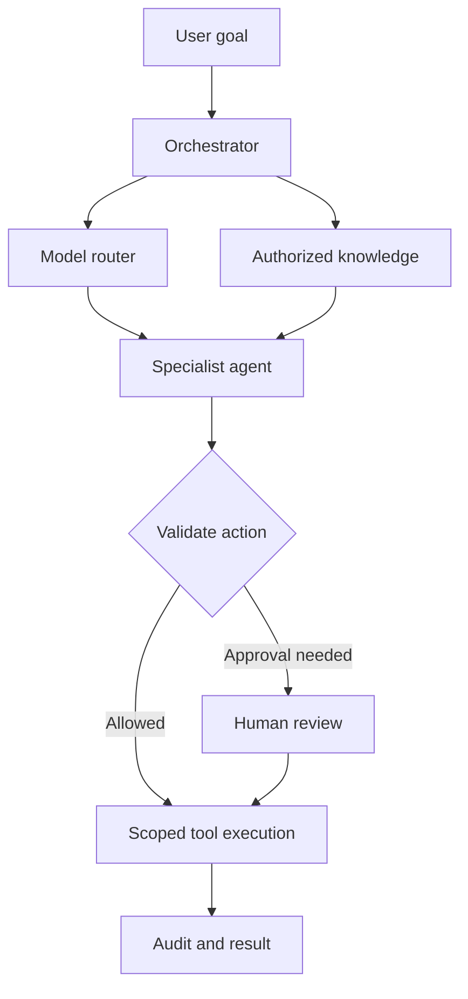
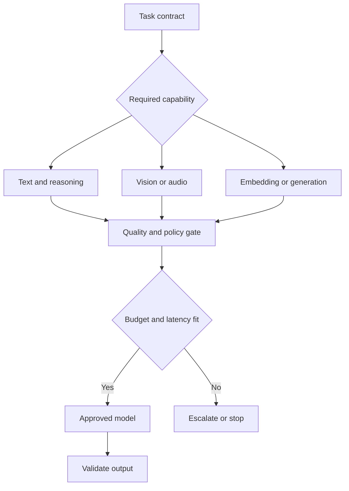
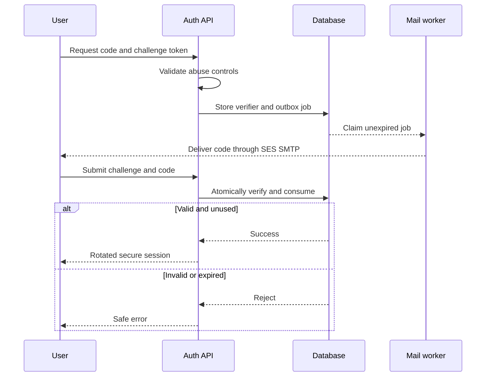
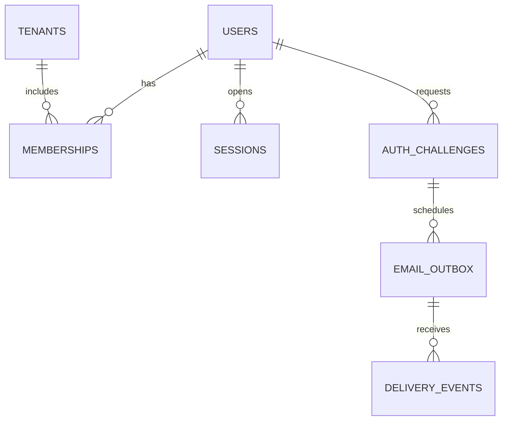
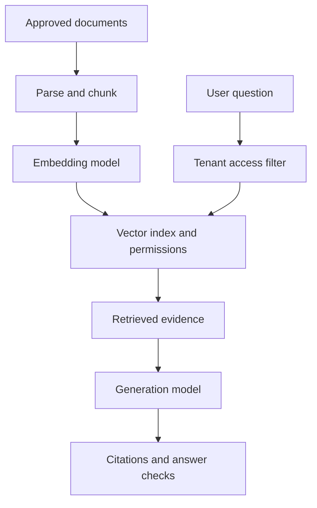
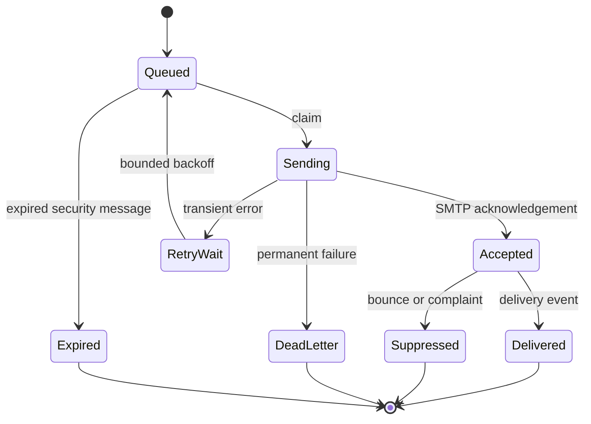
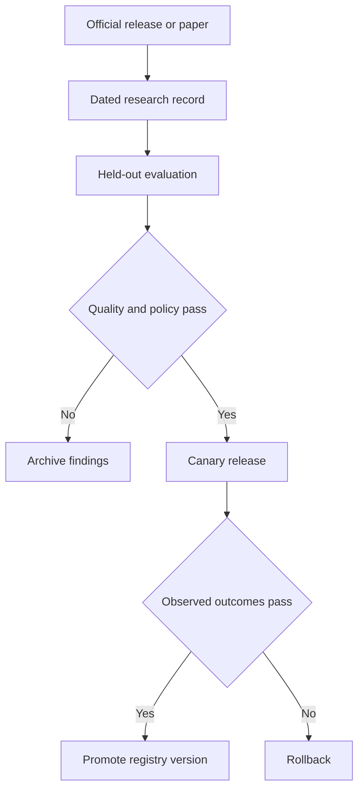

# Mermaid Diagram Library

Copy the fenced blocks directly into GitHub Markdown. The app renders previews and exposes the same copyable source. The site loads pinned Mermaid 12.2.0 from jsDelivr; if unavailable, source remains readable. Logo artwork is preserved.

## Orchestrator and controlled tools

## Task-specific model selection

## OTP issuance and atomic redemption

## Identity and delivery data model

## Authorized retrieval and grounded answers

## Email retries and delivery events

## Research to approved release

