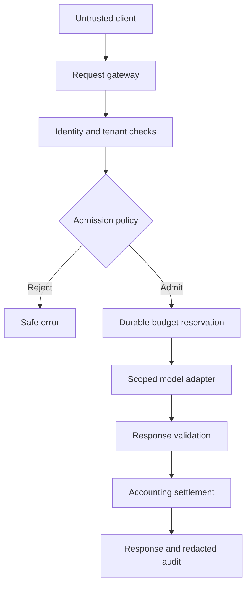
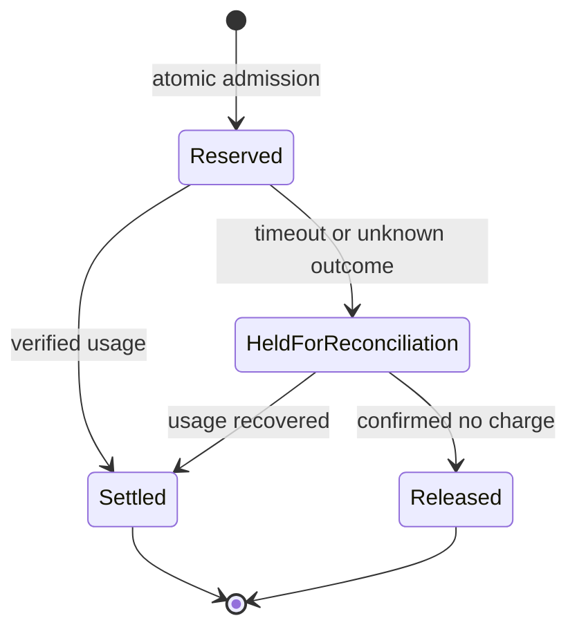

# Page 1 — Production AI Application Architecture and Request Lifecycle

| Metadata | Value |
| --- | --- |
| Document version | 1.0.0 |
| Last reviewed | 2 November 2026 |
| Target scope | Tenant-aware, server-controlled AI inference service; TypeScript application core; GitHub CI; Cloudflare application hosting; managed model adapters |
| Audience | Platform engineers, application developers, security reviewers and operations owners |
| Implementation boundary | A complete, provider-independent request-lifecycle module and executable acceptance tests. Identity verification, durable accounting and provider transport are explicit service contracts. |
| Release status | Architecture reference. Production approval requires the verification matrix below to pass against the actual deployed dependencies. |

## 1. Architectural overview and governing principles

An AI application must control more than model invocation. It must determine who is asking, which tenant owns the request, whether the requested operation is permitted, which data may leave the system, how much work is affordable, and what happens if the client or provider fails halfway through processing.

The model is an untrusted computational dependency. It does not establish identity, assign roles, choose unrestricted network destinations or authorize side effects. The application makes these decisions before invoking it and validates its result afterward. A model-generated string cannot change a permission policy.

The request lifecycle below supports bounded text inference without tools. Tool execution, retrieval, email delivery and account enrollment are separate service capabilities. Their absence is deliberate: an inference endpoint must not accidentally acquire authority to send messages or mutate business records simply because a model supports function calling.

### 1.1 Trust boundaries



The client boundary accepts only a task name, an input string and an output-token ceiling. Tenant membership and permissions arrive from authenticated server state. The adapter boundary translates the application contract into one provider's current API. Budget enforcement happens in a durable accounting boundary shared by all application instances.

Each boundary has an independent failure policy. Authentication failure must not fall through to an anonymous paid request. Budget failure must not invoke the model. A provider timeout is an uncertain outcome because processing may continue remotely. A settlement failure must not silently discard the accounting obligation.

### 1.2 Non-negotiable invariants

1. Every admitted request has a verified principal with an active tenant membership.
2. Every model call follows a successful budget reservation.
3. The reservation precedes the side effect and includes a unique request identifier.
4. Provider selection comes from an approved server registry, never a client-supplied URL.
5. Unsupported tasks and token limits fail before provider invocation.
6. A timeout or transport failure retains its reservation until reconciliation establishes usage or releases it safely.
7. Prompts, API credentials, session tokens and generated private text are excluded from routine logs.
8. The provider's answer remains data. Rendering it must not execute HTML, scripts or commands.

## 2. Detailed system mechanics

### 2.1 Identity and authorization

The HTTP authentication layer verifies the session or access token and constructs a Principal. The principal's user ID, tenant ID and permission set must come from the verified identity and membership records. A browser-submitted tenant header is merely a requested tenant and must be checked against membership.

A permission check applies to the operation, not just the page. A user who can view the chat interface does not automatically have permission to invoke every model, export tenant knowledge or execute administrative tools. The reference module requires the ai:generate permission and an active membership.

Permission changes introduce cache invalidation requirements. A suspended account must lose access within the defined revocation window. If membership is cached, document the maximum stale interval and bypass that cache for privileged actions. Tokens with tenant or role claims require server-side validation and a strategy for revocation.

### 2.2 Input boundaries and token accounting

Limit HTTP body bytes before parsing JSON. After parsing, reject unknown properties, invalid types, blank inputs and unsupported tasks. A character limit is not a token estimate: UTF-8 byte length, Unicode code points and provider tokenization differ.

The accounting service must reserve a conservative upper bound derived from the full provider request: developer instructions, user input, retrieved context, tool schemas, image/audio charges when applicable, the output ceiling and the provider's billing model. The reference uses reservation units rather than money to avoid pretending that a single universal price calculation fits every model.

Provider usage is authoritative only after validating the response schema. Missing usage is an accounting uncertainty, not zero cost. For metered production systems, reconcile provider billing records against application reservations.

### 2.3 Registry and task routing

A registry entry records the task, adapter key, approved model ID, token ceiling and data-processing policy. At deployment, validate each entry against the provider's current capability schema. A model supporting text input does not necessarily support a particular structured-output format, tool schema or reasoning parameter.

As of this review, official catalogs list GPT-6 Astra, GPT-6.1 Sol, GPT-6.1 Terra and GPT-6 Luna; Claude Fable 5.1, Opus 5.5, Sonnet 5.5 and Haiku 5.5; and Gemini 4 Argon and Gemini 3.8 Flash. These are candidate families, not interchangeable endpoint contracts. Choose a model using representative task evaluations and verify account availability. The code below intentionally does not hardcode a provider or a model alias.

### 2.4 Budget lifecycle and uncertain completion



A reservation is not an in-memory counter. Implement it with a transactional store or a coordination mechanism that can atomically compare the tenant's available allowance and create the reservation. Concurrent requests must not overspend by observing the same balance.

Reservation IDs and request IDs must be unique within the intended scope. A retry of an already completed request should retrieve the persisted result or return its existing status instead of spending again. This module generates a new request ID per execution and does not claim HTTP-level idempotency. Add a durable idempotency coordinator before exposing retryable paid mutations.

The adapter may fail after a provider accepted the request. Releasing the entire reservation on every exception allows repeated uncertain requests to bypass spending limits. The safe default is to retain the reservation and enqueue reconciliation. Record expiry and escalation rules so held funds do not remain locked forever.

### 2.5 Timeouts, cancellation and retries

Propagate AbortSignal to the provider transport. A local abort does not prove that the remote provider stopped computation. The deadline implementation races the transport promise so the caller is bounded even if an adapter fails to honor cancellation.

Do not retry a model call automatically after an ambiguous timeout. Retrying can duplicate charges and produce two divergent outputs. Explicit retries must pass admission again and honor the request's durable idempotency state. Rate-limit responses may support a delayed retry, but only within a documented attempt and time budget.

### 2.6 Output safety

An adapter returns text and measured usage through a narrow object contract. The core rejects empty answers, oversized UTF-8 responses and malformed usage. A provider's refusal, incomplete generation and tool-call response require explicit adapter handling; they must not be disguised as successful plain-text completion.

Render model output as text or sanitized Markdown. Do not place it in an unsanitized innerHTML assignment. Treat generated URLs, shell commands, SQL statements and email recipients as untrusted proposals requiring separate validation and authorization.

## 3. Production implementation pattern

The following TypeScript module has no third-party runtime dependencies. It can be compiled with TypeScript targeting ES2022 and the DOM library. It defines all application contracts and the complete orchestration logic within this chapter's boundary.

### 3.1 src/lifecycle.ts

```typescript
export type Task = "assistant" | "code_review";

export interface Principal {
  userId: string;
  tenantId: string;
  membershipActive: boolean;
  permissions: ReadonlySet<string>;
}

export interface GenerationRequest {
  task: Task;
  input: string;
  maxOutputTokens: number;
}

export interface ModelPolicy {
  adapterKey: string;
  modelId: string;
  maxOutputTokens: number;
}

export interface Usage {
  inputTokens: number;
  outputTokens: number;
}

export interface ModelResult {
  text: string;
  usage: Usage;
}

export interface ModelAdapter {
  generate(
    policy: ModelPolicy,
    request: GenerationRequest,
    signal: AbortSignal
  ): Promise<ModelResult>;
}

export interface BudgetLedger {
  reserve(input: {
    requestId: string;
    tenantId: string;
    policy: ModelPolicy;
    request: GenerationRequest;
  }): Promise<{ reservationId: string }>;
  settle(reservationId: string, usage: Usage): Promise<void>;
  holdForReconciliation(
    reservationId: string,
    requestId: string
  ): Promise<void>;
}

export interface AuditEvent {
  requestId: string;
  tenantId: string;
  task: Task;
  outcome: "completed" | "failed" | "reconciliation_failed";
  durationMs: number;
}

export interface Dependencies {
  policies: Readonly<Record<Task, ModelPolicy>>;
  adapters: ReadonlyMap<string, ModelAdapter>;
  ledger: BudgetLedger;
  audit(event: AuditEvent): void;
  now(): number;
  requestId(): string;
  timeoutMs: number;
  maxAnswerBytes: number;
}

export class LifecycleError extends Error {
  constructor(
    public readonly code: string,
    public readonly httpStatus: number
  ) {
    super(code);
    this.name = "LifecycleError";
  }
}

export function parseRequest(value: unknown): GenerationRequest {
  if (!value || typeof value !== "object" || Array.isArray(value)) {
    throw new LifecycleError("invalid_request", 400);
  }

  const item = value as Record<string, unknown>;
  const allowed = new Set(["task", "input", "maxOutputTokens"]);
  if (Object.keys(item).some((key) => !allowed.has(key))) {
    throw new LifecycleError("unknown_property", 400);
  }
  if (item.task !== "assistant" && item.task !== "code_review") {
    throw new LifecycleError("unsupported_task", 400);
  }
  if (
    typeof item.input !== "string" ||
    item.input.trim().length === 0 ||
    new TextEncoder().encode(item.input).byteLength > 16_384
  ) {
    throw new LifecycleError("invalid_input", 400);
  }
  if (
    typeof item.maxOutputTokens !== "number" ||
    !Number.isSafeInteger(item.maxOutputTokens) ||
    item.maxOutputTokens < 1 ||
    item.maxOutputTokens > 4_096
  ) {
    throw new LifecycleError("invalid_output_limit", 400);
  }

  return {
    task: item.task,
    input: item.input,
    maxOutputTokens: item.maxOutputTokens
  };
}

function validateUsage(usage: Usage): void {
  if (
    !usage ||
    !Number.isSafeInteger(usage.inputTokens) ||
    usage.inputTokens < 0 ||
    !Number.isSafeInteger(usage.outputTokens) ||
    usage.outputTokens < 0
  ) {
    throw new LifecycleError("invalid_provider_usage", 502);
  }
}

export async function generate(
  principal: Principal,
  raw: unknown,
  deps: Dependencies
): Promise<{ requestId: string; text: string; usage: Usage }> {
  if (
    !principal.userId ||
    !principal.tenantId ||
    !principal.membershipActive ||
    !principal.permissions.has("ai:generate")
  ) {
    throw new LifecycleError("forbidden", 403);
  }

  const request = parseRequest(raw);
  const policy = deps.policies[request.task];
  if (
    !policy ||
    !policy.modelId ||
    request.maxOutputTokens > policy.maxOutputTokens
  ) {
    throw new LifecycleError("task_policy_rejected", 400);
  }

  const adapter = deps.adapters.get(policy.adapterKey);
  if (!adapter) {
    throw new LifecycleError("adapter_unavailable", 503);
  }
  if (
    !Number.isSafeInteger(deps.timeoutMs) ||
    deps.timeoutMs < 1 ||
    !Number.isSafeInteger(deps.maxAnswerBytes) ||
    deps.maxAnswerBytes < 1
  ) {
    throw new LifecycleError("invalid_runtime_policy", 503);
  }

  const requestId = deps.requestId();
  const started = deps.now();
  const reservation = await deps.ledger.reserve({
    requestId,
    tenantId: principal.tenantId,
    policy,
    request
  });

  let timer: ReturnType<typeof setTimeout> | undefined;
  const controller = new AbortController();
  const emit = (outcome: AuditEvent["outcome"]): void => {
    try {
      deps.audit({
        requestId,
        tenantId: principal.tenantId,
        task: request.task,
        outcome,
        durationMs: Math.max(0, deps.now() - started)
      });
    } catch {
      // Audit transport health must be monitored independently.
      // Never expose private provider errors through this path.
    }
  };

  try {
    const deadline = new Promise<never>((_, reject) => {
      timer = setTimeout(() => {
        controller.abort();
        reject(new LifecycleError("provider_timeout", 504));
      }, deps.timeoutMs);
    });

    const result = await Promise.race([
      adapter.generate(policy, request, controller.signal),
      deadline
    ]);
    validateUsage(result.usage);

    if (
      typeof result.text !== "string" ||
      result.text.trim().length === 0 ||
      new TextEncoder().encode(result.text).byteLength >
        deps.maxAnswerBytes
    ) {
      throw new LifecycleError("invalid_provider_output", 502);
    }

    await deps.ledger.settle(reservation.reservationId, result.usage);
    emit("completed");
    return { requestId, text: result.text, usage: result.usage };
  } catch (error) {
    try {
      await deps.ledger.holdForReconciliation(
        reservation.reservationId,
        requestId
      );
    } catch {
      emit("reconciliation_failed");
    }
    emit("failed");
    if (error instanceof LifecycleError) {
      throw error;
    }
    throw new LifecycleError("generation_failed", 502);
  } finally {
    if (timer !== undefined) {
      clearTimeout(timer);
    }
  }
}
```

### 3.2 Contract requirements for dependency implementations

The ledger's reserve operation must reject exhausted or suspended tenants before returning a reservation ID. Settle must be idempotent and must not double-charge when the same usage is submitted twice. Hold must not overwrite a previously settled reservation. Because settlement itself can fail after committing, reconciliation must inspect durable state before applying another charge.

Ledger operations require their own bounded storage deadlines. The model deadline does not bound a stalled database call. The HTTP host should enforce an overall request deadline and reserve time for reconciliation or dispatch that work durably. An execution context's background callback is not a substitute for a durable queue when losing work would lose billing records.

The adapter must enforce its own response-body size limit before parsing, translate provider-specific refusal/incomplete states into typed failures, and validate usage fields. It must not accept a request-provided base URL. API credentials belong in managed secrets and must not appear in policies or audit events.

The audit implementation should be nonblocking and feed a monitored transport with a defined loss policy. A deployment requiring fail-closed compliance audit must reject admission when durable audit is unavailable; the reference's best-effort telemetry hook does not satisfy that stronger requirement.

## 4. Complete executable acceptance test

The test uses an in-memory ledger only as a deterministic test double. It is not a production accounting implementation and does not claim distributed atomicity.

### 4.1 src/lifecycle.test.ts

```typescript
import {
  generate,
  LifecycleError,
  type BudgetLedger,
  type Dependencies,
  type ModelAdapter,
  type Principal,
  type Usage
} from "./lifecycle.js";

function assert(condition: unknown, message: string): asserts condition {
  if (!condition) throw new Error(message);
}

async function rejects(
  operation: () => Promise<unknown>,
  code: string
): Promise<void> {
  try {
    await operation();
  } catch (error) {
    assert(error instanceof LifecycleError, "Expected LifecycleError");
    assert(error.code === code, "Unexpected error code");
    return;
  }
  throw new Error("Expected rejection");
}

const states = new Map<string, string>();
let reservations = 0;
let adapterCalls = 0;

const ledger: BudgetLedger = {
  async reserve(input) {
    reservations += 1;
    states.set(input.requestId, "reserved");
    return { reservationId: input.requestId };
  },
  async settle(id: string, usage: Usage) {
    assert(usage.outputTokens >= 0, "Invalid usage");
    states.set(id, "settled");
  },
  async holdForReconciliation(id: string) {
    if (states.get(id) !== "settled") states.set(id, "held");
  }
};

const adapter: ModelAdapter = {
  async generate() {
    adapterCalls += 1;
    return {
      text: "Validated response",
      usage: { inputTokens: 12, outputTokens: 4 }
    };
  }
};

let sequence = 0;
const deps: Dependencies = {
  policies: {
    assistant: {
      adapterKey: "test",
      modelId: "deterministic-test-adapter",
      maxOutputTokens: 1024
    },
    code_review: {
      adapterKey: "test",
      modelId: "deterministic-test-adapter",
      maxOutputTokens: 1024
    }
  },
  adapters: new Map([["test", adapter]]),
  ledger,
  audit() {},
  now: () => Date.now(),
  requestId: () => "request-" + (++sequence),
  timeoutMs: 50,
  maxAnswerBytes: 4096
};

const principal: Principal = {
  userId: "test-user",
  tenantId: "test-tenant",
  membershipActive: true,
  permissions: new Set(["ai:generate"])
};

const input = {
  task: "assistant",
  input: "Explain a transactional outbox.",
  maxOutputTokens: 128
};

const result = await generate(principal, input, deps);
assert(result.text === "Validated response", "Wrong response");
assert(states.get(result.requestId) === "settled", "Not settled");

const beforeDenied = reservations;
await rejects(
  () => generate({ ...principal, membershipActive: false }, input, deps),
  "forbidden"
);
assert(reservations === beforeDenied, "Denied request reserved budget");

await rejects(
  () => generate(principal, { ...input, model: "client-choice" }, deps),
  "unknown_property"
);

const failing: ModelAdapter = {
  async generate() {
    throw new Error("Sensitive upstream detail");
  }
};
await rejects(
  () => generate(principal, input, {
    ...deps,
    adapters: new Map([["test", failing]])
  }),
  "generation_failed"
);
assert(states.get("request-" + sequence) === "held", "Failure not held");

const stalled: ModelAdapter = {
  async generate() {
    return new Promise(() => {});
  }
};
await rejects(
  () => generate(principal, input, {
    ...deps,
    timeoutMs: 5,
    adapters: new Map([["test", stalled]])
  }),
  "provider_timeout"
);
assert(states.get("request-" + sequence) === "held", "Timeout not held");
assert(adapterCalls === 1, "Unexpected successful adapter calls");
console.log("Lifecycle acceptance tests passed");
```

### 4.2 Compiler configuration

Save this complete configuration as tsconfig.json. Install TypeScript as a development dependency, commit the generated package lock, and use the same locked compiler in CI.

```json
{
  "compilerOptions": {
    "target": "ES2022",
    "module": "NodeNext",
    "moduleResolution": "NodeNext",
    "lib": ["ES2022", "DOM"],
    "strict": true,
    "outDir": "dist",
    "rootDir": "src",
    "skipLibCheck": true,
    "noEmitOnError": true
  },
  "include": ["src/**/*.ts"]
}
```

Set the package's type field to module so the test's top-level await uses ECMAScript modules. Run the compiler followed by the emitted test:

```sh
npm pkg set type=module
npm install --save-dev typescript
npx tsc --project tsconfig.json
node dist/lifecycle.test.js
```

Do not substitute synthetic model IDs into a live provider. The deterministic-test-adapter string is a real test fixture identifier consumed only by the test double.

## 5. Deployment configuration and secret boundaries

This chapter's module does not start a public HTTP listener. Integrate it behind the application's authenticated gateway, then bind concrete ledger and provider adapters. Publishing a raw unauthenticated wrapper would violate the invariants in Section 1.

For a Cloudflare deployment, keep the compatibility date explicit and use version-controlled non-secret configuration. Provision provider credentials as Worker secrets or approved Secret Store bindings. Verify each environment separately because resource and secret binding behavior must not be assumed to inherit across environments.

The following is an application policy document, not a Wrangler manifest. An admission configuration loader must validate every property and reject unknown keys.

```yaml
version: 1
request_policy:
  maximum_body_bytes: 24576
  maximum_input_utf8_bytes: 16384
  maximum_output_tokens: 4096
  maximum_answer_utf8_bytes: 65536
  model_deadline_ms: 25000
  require_active_membership: true
  required_permission: ai:generate
  automatic_provider_retries: 0
accounting_policy:
  reserve_before_inference: true
  unknown_outcome: hold_for_reconciliation
  settlement_idempotency: required
logging_policy:
  include_request_id: true
  include_tenant_id: true
  include_duration: true
  include_prompt: false
  include_generated_text: false
  include_credentials: false
```

The limits are deliberately local policy values, not provider quotas. The gateway body limit is larger than the input-string limit to allow JSON syntax and metadata while bounding memory use. The output byte ceiling is independent of output-token limits. A generated Unicode answer can consume more bytes than its visible length suggests.

A Docker image is not needed for the Workers runtime. Container deployment is a separate target requiring its own HTTP server, signal handling, health checks and secret injection. Including a nonfunctional Dockerfile would make this chapter less complete, not more deployable.

## 6. Acceptance, testing and verification matrix

| Area | Concrete test | Required result |
| --- | --- | --- |
| Identity | Expired session reaches gateway | 401 before lifecycle invocation; no reservation or model call |
| Authorization | Inactive membership or missing permission | 403; no provider activity |
| Tenant isolation | Client changes tenant header or object ID | Membership check rejects unauthorized tenant |
| Input schema | Unknown property, blank input, array body, unsupported task | 400 before reservation |
| Unicode | Input exceeds 16,384 UTF-8 bytes with multibyte characters | Rejected using encoded byte length |
| Token policy | Output ceiling exceeds registry maximum | Rejected before inference |
| Registry | Adapter missing or model unapproved | Fail closed; no user-controlled fallback |
| Budget concurrency | Parallel requests compete for final allowance | Durable ledger admits only affordable reservations |
| Successful completion | Adapter returns valid text and usage | Exactly one idempotent settlement and safe response |
| Provider transport | Connection resets after request submission | Reservation retained for reconciliation |
| Timeout | Adapter ignores AbortSignal | Caller still receives bounded timeout |
| Output | Empty text, oversized bytes or invalid usage | 502; uncertain spend remains reserved |
| Settlement uncertainty | Database commits then connection fails | Reconciliation reads existing state; no duplicate charge |
| Telemetry | Audit destination fails | Alert under defined loss policy; no credential leakage |
| Rendering | Model emits script, HTML or executable command | Displayed as inert data; no automatic execution |
| Retry | Client resubmits a paid request | Durable idempotency coordinator applies documented replay policy |
| Recovery | Held reservation exceeds reconciliation objective | Alert and audited investigation; no silent release |
| Secrets | Inspect static assets and logs | No provider keys, OTPs, bearer tokens or private prompts |
| Rollback | Registry version regresses quality | Restore approved version without weakening authorization |

### 6.1 Operational objectives

Define service objectives before launch: admission availability, successful-request latency, timeout rate, unresolved-reservation age and cost per accepted task. Set thresholds from measured staging traffic and the business risk profile. The chapter does not invent universal production percentages.

Alert on oldest unresolved reservation, repeated settlement errors, provider authorization failures and unexpected token growth. A model outage should degrade the AI feature while preserving identity, accounting records and ordinary application access.

### 6.2 Known implementation traps

An in-memory limiter is instance-local and cannot enforce a global tenant allowance. A provider API key scoped to a whole organization can exceed the authority needed by one application. A fallback model with different retention terms can violate a data-processing policy even when its output is correct. A provider response marked incomplete may include text that must not be accepted as a finished result. Setting a provider's store flag to false does not by itself establish contractual zero-data-retention coverage.

## 7. Official provider and standards references

- [OpenAI model catalog](https://developers.openai.com/api/docs/models): current model families and capability discovery.
- [OpenAI Responses create reference](https://developers.openai.com/api/reference/resources/responses/methods/create): provider request and response semantics.
- [Claude model overview](https://platform.claude.com/docs/en/models/overview): model IDs, capabilities and lifecycle.
- [Gemini model catalog](https://ai.google.dev/gemini-api/docs/models): model endpoints and modality-specific choices.
- [Cloudflare Worker configuration](https://developers.cloudflare.com/workers/wrangler/configuration/): deployment configuration.
- [Cloudflare Worker secrets](https://developers.cloudflare.com/workers/configuration/secrets/): runtime credential handling.
- [OWASP Authentication Cheat Sheet](https://cheatsheetseries.owasp.org/cheatsheets/Authentication_Cheat_Sheet.html): identity control boundaries.
- [OWASP Authorization Cheat Sheet](https://cheatsheetseries.owasp.org/cheatsheets/Authorization_Cheat_Sheet.html): permission checks and least privilege.
- [Mermaid documentation](https://mermaid.js.org/config/usage.html): editable diagram syntax and rendering.

## 8. Chapter completion and next page

Page 1 defines the lifecycle, trust boundaries, complete orchestration module, deterministic tests, policy configuration and deployment acceptance requirements. It does not assert that a public service has been provisioned or approved.

The next standalone chapter is **Page 2 — Identity, Authentication, SSO, Sessions and Tenant Authorization**. It will define the concrete gateway boundary used by this lifecycle. Ready to proceed to Page 2.
